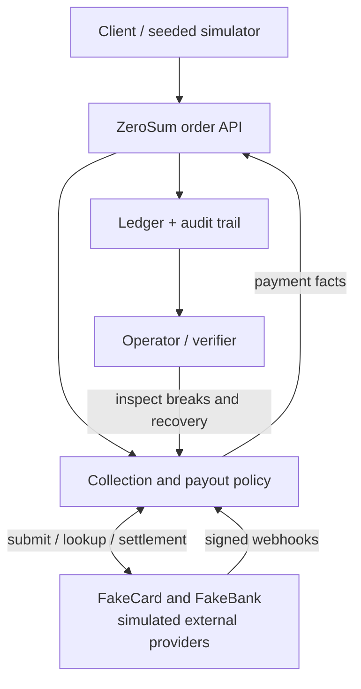
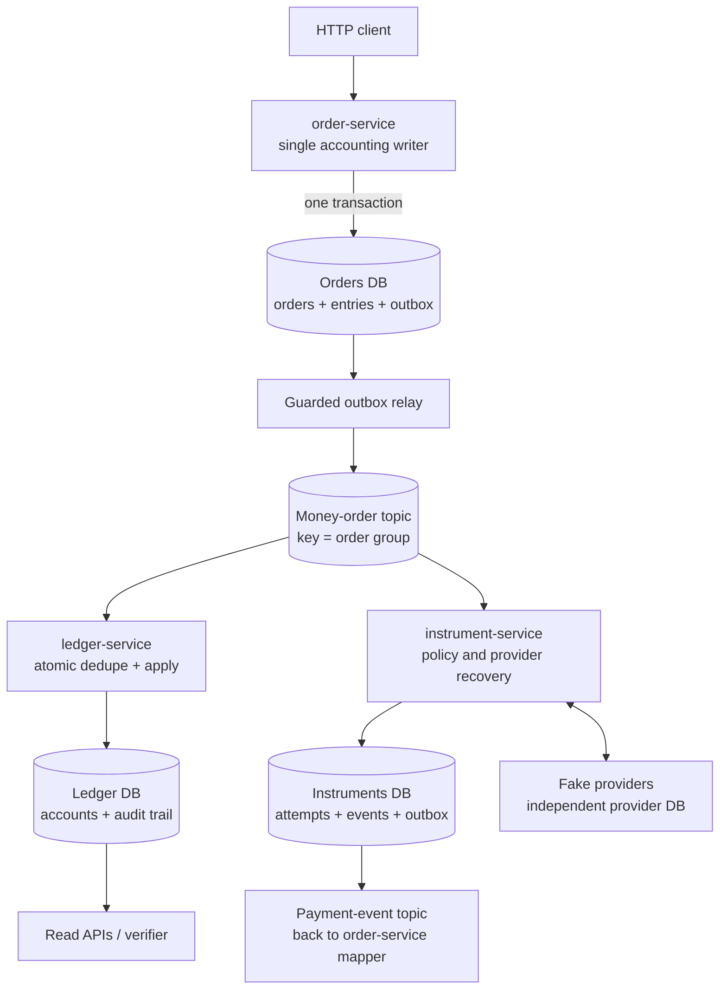
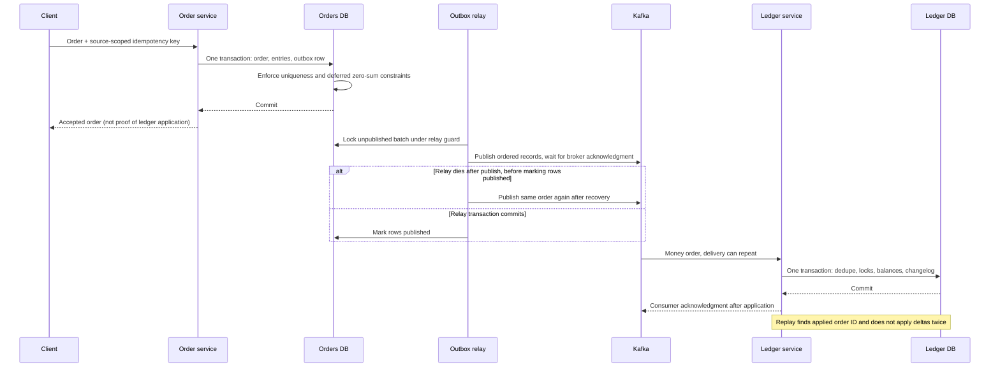
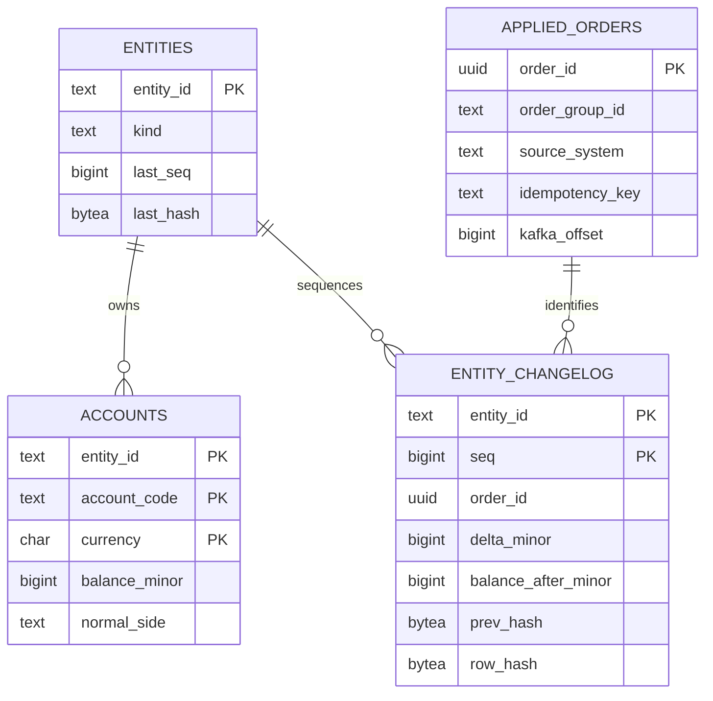
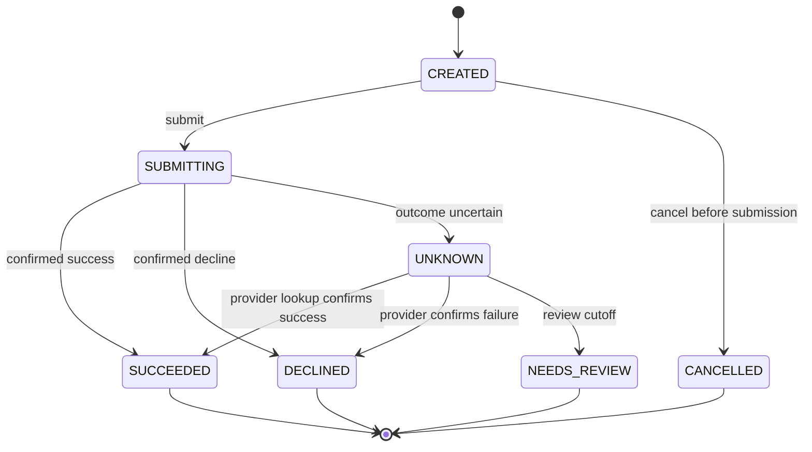
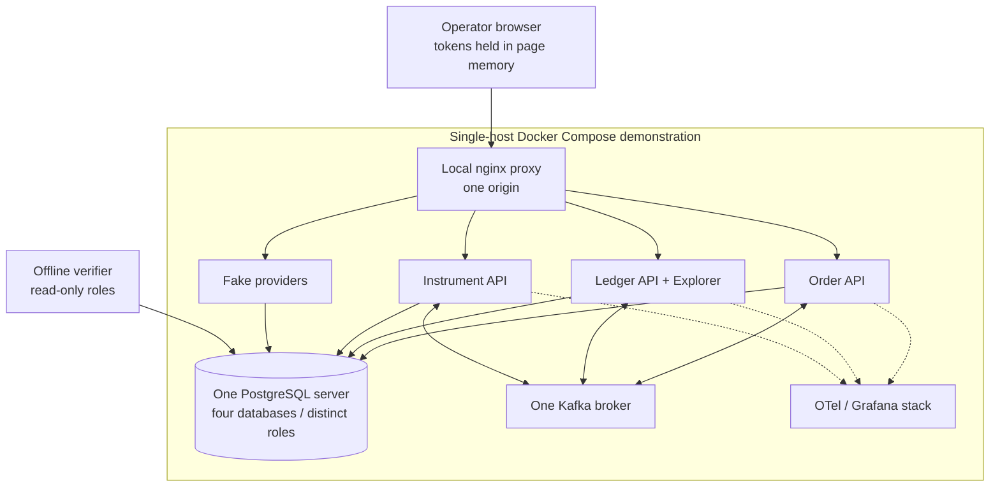

# ZeroSum Ledger architecture

**An accepted money movement must remain balanced and explainable through crashes, retries, and uncertain provider outcomes.**

ZeroSum is a Java/Spring Boot payments-system lab with an immutable order store, a separately applied ledger,
and deliberately mismatched fake payment providers. It is a portfolio system using simulated funds, not a
production payments platform.

This guide connects the implementation, alternatives, and failure semantics. The ten [formal ADRs](docs/adr/)
remain the decision record; [acceptance criteria and coverage](docs/architecture.md) remain the evidence register.
Comparisons below are design reasoning, not claims that every competing database or broker was benchmarked.

## 1. Design drivers and invariants

| Driver | Invariant / boundary | Mechanism | Tradeoff |
| --- | --- | --- | --- |
| Monetary correctness | Each order nets to zero separately for each currency | Signed integer minor units, domain validation, deferred database constraints | FX and cross-currency netting are outside scope |
| Auditability | Applied history cannot be silently rewritten | Append-only orders/changelog, sequence numbers, hash chains | Corrections need compensating orders |
| Delivery under failure | Commit and eventual publication cannot split into an untracked gap | Transactional outbox and idempotent consumers | Duplicate delivery is expected |
| Provider uncertainty | A timeout cannot be treated as proof of failure | Explicit `UNKNOWN`, lookup, state machines, sweeper | Resolution can delay completion and require review |
| Clear ownership | One service owns each write model | Separate databases/roles and event/API contracts | Eventual consistency replaces cross-store transactions |
| Inspectable operations | A healthy HTTP endpoint is not proof that books agree | Invariants, freshness, reconciliation, verifier, traces | Operators must interpret several independent signals |

## 2. System context

The fake providers have their own state and fault behavior. Keeping them outside the service's transaction
boundary makes a lost response after a successful charge observable. A mock that simply throws before writing
anything cannot demonstrate that failure mode.

## 3. Containers, stores, and event ownership

There are **four logical databases on one local PostgreSQL server**, not four independently available database
clusters. Runtime services do not read each other's tables. The offline verifier is an explicit exception: it
uses read-only credentials to reconcile stores. The Explorer reads service APIs through a one-origin proxy.
The combined orders/outbox store represents a local transaction; arrows through Kafka do not.
The payment-event topic feeds the mapper in the same order-service shown at the top; that callback is labeled
rather than drawing a long feedback arrow through every ownership boundary.

Source map: [order store](services/order-service/src/main/java/dev/zerosum/order/order/OrderStore.java),
[outbox library](libs/outbox/), [ledger apply](services/ledger-service/src/main/java/dev/zerosum/ledger/apply/),
[instrument domain](services/instrument-service/src/main/java/dev/zerosum/instrument/),
[verifier](tools/verifier/).

## 4. Write path, commit points, and replay

Two important boundaries follow. An API acknowledgment means the order and outbox are committed, while
ledger application is asynchronous. Broker delivery is at least once; the database's atomic deduplication and
apply path provide effectively-once ledger effects. This is not a distributed exactly-once transaction spanning
PostgreSQL, Kafka, and a payment provider.

## 5. Ledger data model and audit chain

This is a **logical view of the ledger database**. Relationships show ownership and audit references; only the
schema's declared constraints are physical foreign keys. In particular, the drawing does not invent a
cross-database foreign key back to the orders service.

Accounts are the current read model; the changelog is the audit history. Per-entity sequences and hashes link
successive changes, and `applied_orders` identifies the source movement. A read-only verifier can recompute
balances and inspect sequence/hash continuity. A hash chain detects inconsistent history under its threat
model; it is not external notarization and cannot protect against every privileged rewrite of all related state.
[Schema](services/ledger-service/src/main/resources/db/migration/V2__ledger_schema.sql) ·
[Store](services/ledger-service/src/main/java/dev/zerosum/ledger/store/LedgerStore.java).

## 6. An uncertain charge is a state, not an exception to ignore

The following is the **charge** lifecycle, simplified from the authoritative transition tables. Refunds rename
the failure outcome, and payouts have separate `PENDING`, `SETTLED`, `RETURNED`, and recovery paths.

A webhook, submission response, and sweeper can race. Updates compare both version and prior status; losing
a race is an expected result that requires rereading state. The transition and its emitted payment event are
committed together. Stale observations are distinguished from ahead-of-state observations that require lookup
and intermediate transitions. [State-machine data](services/instrument-service/src/main/java/dev/zerosum/instrument/store/AttemptStateMachines.java) ·
[Guarded transitions](services/instrument-service/src/main/java/dev/zerosum/instrument/store/AttemptTransitions.java).

## System-design reasoning: put each guarantee inside a boundary that can enforce it

The priority order is **monetary correctness, explainability, recoverable progress, then latency/throughput**.
That is why the design tolerates a paused consumer or an unresolved attempt rather than turning uncertainty into
a second payment or skipping a valid order. These priorities are appropriate to the lab's problem; they are not
a universal argument for service decomposition or Kafka.

### Consistency is a set of local contracts

| Operation | Strong local boundary | Cross-boundary consequence |
| --- | --- | --- |
| Accept an HTTP order | Orders, entries, idempotency constraint, and outbox commit together | The ledger can lag an already acknowledged order |
| Apply a ledger batch | Deduplication, entity locks, balance updates, and changelog commit together | Kafka can redeliver after the DB commit; replay must be harmless |
| Advance an attempt | Expected version/status and the emitted event share a transaction | A late webhook can still race with a lookup and must be reconciled |
| Submit to a provider | Provider-specific idempotency/lookup contract | No local DB transaction can atomically include an external provider's effect |
| Decide payout eligibility | Policy reads freshness/balances and enforces its local constraints | This is not an atomic cross-service reservation against every concurrent adjustment |

Saying “PostgreSQL is ACID” does not establish an atomic transaction across these rows of the table.
Likewise, Kafka's per-key order does not serialize all orders touching a shared entity. The architecture deliberately
combines message ordering, database concurrency control, idempotency, and recovery; none substitutes for the others.

### Capacity: scale the contended write, not the diagram

A hot entity's sequence/hash head is a serialization point. More Kafka partitions or consumer threads cannot
make simultaneous updates to that same entity independent. Batching amortizes transaction overhead but holds
locks longer, increasing latency and reducing fairness for competing batches. Spreading a hot account across
sub-accounts can improve throughput, but changes aggregation, reconciliation, and account-model complexity.
The [recorded contention studies](docs/results/perf/perf-summary.md) are the evidence for those tradeoffs on the
stated laptop, not a production sizing formula.

At a pipeline stage with arrival rate `lambda` and sustainable apply rate `mu`, a backlog cannot drain if
`mu <= lambda`. If a backlog of `B` remains after an outage and a steady `mu > lambda` is restored, the simple
planning estimate is `B / (mu - lambda)` time to drain. Real batching, locks, provider limits, and variable traffic
change that estimate. Operationally, recovery headroom matters as well as steady-state throughput: meeting an
API-latency target while the outbox grows indefinitely is not a healthy system.

### Why these service boundaries, and why not always use them?

Separating orders, ledger apply, and provider policy makes authority and failure modes explicit and allows the
fault experiments to cross real process boundaries. It also incurs multiple databases, brokers, contracts,
deployment steps, and eventual consistency. For a small team without the need to study or independently operate
these boundaries, a modular monolith with one transactional database could be a more economical starting point.
The local deployment still shares one host/database server/broker, so the current split does not buy independent
infrastructure availability merely by drawing separate service boxes.

| Changed requirement | The assumption it invalidates | Architectural work required |
| --- | --- | --- |
| Never pay out beyond a concurrently changing entitlement | Freshness-gated asynchronous policy is not a reservation | Reservation/authorization protocol, explicit expiry/release, and revised invariants |
| Survive a broker or database-host failure while serving traffic | The demo's single-instance topology | Replication, failover, recovery drills, and measured RPO/RTO; not only extra application replicas |
| Add foreign exchange | Zero sum is currently defined independently within each currency | Explicit FX rates, rounding/gain-loss accounting, and new reconciliation rules |
| Add a provider with no safe uncertainty-resolution contract | The adapter's lookup/idempotency/quiet-period assumptions | Reject unsupported semantics or redesign the business flow; a retry loop is not a substitute |
| Increase throughput on one platform entity | Entity ordering remains the write bottleneck | Measured batching/account spreading or a different consistency/data model, with invariant revalidation |

## 7. Decisions, alternatives, costs, and change triggers

### D1 — Signed minor units and zero sum per currency

**Chosen:** a debit is positive, a credit negative, and amounts use integer minor units. A multi-leg order must
sum to exactly zero for each currency. Both the application and database enforce structural validity, so a
bypassed Java check does not automatically become an accepted unbalanced order.

**Alternatives:** floating-point amounts introduce rounding behavior into an exact invariant. Separate debit
and credit columns or direction flags are valid models, but require every consumer to combine more fields and
make invalid combinations representable. Netting currencies together would require an explicit FX model that
this project does not implement.

**Cost / revisit:** currency precision, overflow, and account normal-side presentation need deliberate rules.
Revisit representation when adding supported currencies or FX, with migration and invariant changes rather
than a formatting patch. [ADR-0003](docs/adr/0003-sign-convention.md) · [Money domain](libs/money/).

### D2 — One money-order writer; payment services publish facts

**Chosen:** order-service validates and creates every money order. Instrument-service publishes payment events;
a pure mapper derives orders using event time and `event_id`-based idempotency, so replay remains deterministic.

**Alternatives:** letting each service write ledger deltas independently reduces the extra hop but duplicates
accounting rules and idempotency behavior. Direct database writes also couple providers to the ledger's schema.
A modular monolith could simplify deployment and transactions; this project's service split is useful for
studying ownership and failure boundaries, not evidence that every small payments system needs microservices.

**Cost / revisit:** the event loop adds lag and operational complexity. Preserve a single accounting authority
if deployment boundaries are consolidated or more event types are added.
[ADR-0006](docs/adr/0006-order-service-is-the-single-writer.md) ·
[Pure mapper](services/order-service/src/main/java/dev/zerosum/order/mapping/PaymentEventMapper.java).

### D3 — Transactional outbox instead of an API-thread dual write

**Chosen:** the order and publish intent share a database transaction. A polling relay waits for broker
acknowledgment before committing publication state. A transaction-scoped advisory guard serializes relay
batches; `SKIP LOCKED` alone would permit later rows to overtake earlier ones under multiple relays.

**Alternatives:** writing PostgreSQL and then Kafka directly leaves a crash gap; reversing the order can publish
an uncommitted order. Kafka transactions do not atomically commit the PostgreSQL transaction. CDC/Debezium can
remove polling and improve a constrained relay, but introduces connector/WAL retention/operational concerns.

**Cost / revisit:** duplicates, relay head-of-line blocking, polling delay, and outbox retention are explicit
costs. Revisit CDC when measured publish lag or relay throughput exceeds the application's needs, not merely
because a connector exists. [ADR-0008](docs/adr/0008-polling-outbox-single-relay.md) ·
[Relay](libs/outbox/src/main/java/dev/zerosum/outbox/OutboxRelay.java).

### D4 — Partition by order group; serialize shared entities in PostgreSQL

**Chosen:** `order_group_id` keeps a trip/group's records on one Kafka partition. Database locks, not Kafka
alone, protect entities shared by different groups. The configured partition count is a contract; increasing
it can remap existing groups and is treated as a migration rather than a harmless scale switch.

**Alternatives:** a random key spreads load but loses group order. An entity key cannot represent every entity
in a multi-leg order and can concentrate platform traffic. A single partition gives total order at an
unnecessary throughput cost. Ordering one group's messages still does not serialize all other groups that
write the same platform account.

**Cost / revisit:** hot groups remain hot partitions, and repartitioning requires a drain/migration plan.
[ADR-0007](docs/adr/0007-partition-key.md) · [Kafka listener](services/ledger-service/src/main/java/dev/zerosum/ledger/kafka/MoneyOrderListener.java).

### D5 — Pessimistic entity locks plus atomic dedupe and apply

**Chosen:** apply runs a `READ COMMITTED` transaction, serializing on entity rows in deterministic key order.
Sequence/hash heads, balance changes, and changelog rows are computed under those locks. Order-ID deduplication
is in the same transaction, so recording “already applied” cannot commit separately from the monetary effect.

**Alternatives:** optimistic account versions would still need a serialization point for gapless per-entity
sequences and hashes. `SERIALIZABLE` can be appropriate, but here may exchange hot-row waits for retries.
Skipping a locked balance update is unacceptable: queue liveness cannot justify skipping money.

**Cost / revisit:** hot entities serialize work, and large batches extend lock hold time. Deterministic ordering
prevents a class of lock cycles, not every possible database failure: provisioning child rows and conflict-skipping
inserts also need consistent ordering. Classified transient failures retry whole transactions; exhausting retries
pauses consumption rather than quarantining valid money. Revisit account spreading/batch size using lock-wait
measurements. [ADR-0005](docs/adr/0005-ledger-entity-locks.md) ·
[Apply engine](services/ledger-service/src/main/java/dev/zerosum/ledger/apply/LedgerApplyEngine.java) ·
[Contention evidence](docs/results/perf/quiet-rerun.md).

### D6 — Keep payout policy outside the ledger

**Chosen:** ledger apply checks structural validity. Balance-dependent eligibility, freshness, minimum payouts,
and one-in-flight payout rules live in instrument-service. A negative balance is an explainable state rather
than an excuse to discard an already accepted movement.

**Alternatives:** enforcing payout policy during ledger consumption could reject an order after it has already
been accepted and published. A reservation-based design can enforce stronger spending constraints, but requires
an explicit reservation lifecycle and a different consistency contract.

**Cost / revisit:** a payout racing a downward adjustment can create driver debt. The system reports this;
it does not pretend asynchronous eligibility is an atomic reservation. Revisit the policy model if hard
no-overdraft semantics become a requirement. [ADR-0004](docs/adr/0004-balance-policy-outside-ledger.md) ·
[Payout service](services/instrument-service/src/main/java/dev/zerosum/instrument/payouts/PayoutRunService.java).

### D7 — Capability-driven providers and explicit uncertain outcomes

**Chosen:** `PaymentInstrument` exposes normalized outcomes and capabilities. A lookup that returns `NotFound`
is different from one that is `Unavailable`. FakeCard supports idempotency keys; FakeBank deliberately does not,
so recovery must follow a different, bounded quiet-period contract before a permitted resubmission.

**Alternatives:** treating a timeout as a decline or blindly retrying with a fresh key can double-charge.
Provider-name conditionals spread special cases throughout policy; falsely claiming all providers support the
same semantics hides the actual recovery problem.

**Cost / revisit:** a quiet-period rule relies on a provider behavior bound, not a mathematical exactly-once
protocol. The existing ADR documents the residual late-completion risk. Adding an adapter requires demonstrating
its lookup/idempotency/settlement capabilities and failure behavior, not only implementing HTTP methods.
[ADR-0010](docs/adr/0010-payment-instrument-abstraction.md) ·
[Resolver](services/instrument-service/src/main/java/dev/zerosum/instrument/recovery/AttemptResolver.java).

### D8 — Reconcile independently; preserve discrepancies

**Chosen:** provider settlement reports are compared with internal expected movements, producing typed breaks.
A read-only verifier separately reconstructs invariant checks across stores. A residual difference remains
visible; it is not silently “fixed” by inventing an adjustment.

**Alternatives:** relying only on successful HTTP responses misses late, missing, duplicated, or corrupted
settlement facts. Having the same code path both write and certify its own balances can reproduce its own bug.
Automatic reconciliation adjustments may be useful, but require authorization and auditable policy absent here.

**Cost / revisit:** report timing, provider formats, and the distinction between a pending lag and a persistent
break need operator interpretation. Revisit automation only with explicit break-resolution workflows and evidence.
[Reconciliation](services/instrument-service/src/main/java/dev/zerosum/instrument/recon/ReconciliationService.java) ·
[Live reconciliation evidence](docs/results/s06/reconciliation-live.md) · [Verifier](tools/verifier/).

### D9 — PostgreSQL as the enforceable write model, rather than treating the event log as the ledger

**Chosen:** relational constraints, transactions, explicit row locking, unique idempotency keys, SQL inspection,
and independently recomputable balances fit the current multi-leg accounting model. Kafka transports facts;
it is not a substitute for the database transaction that enforces a balanced, deduplicated apply.

**Alternatives:** a document database can also offer transactions, but this project would need to re-establish
cross-entry balance enforcement, concurrent idempotency, sequence/hash serialization, and read/verifier behavior
under that engine's model. A log-first event-sourced ledger would need durable retention, deterministic versioned
replay, projection recovery, and a clear authority for invariants. A dedicated ledger engine can offer stronger
specialized primitives, but its transfer/account model must be mapped to this project's multi-leg orders and
provider/reconciliation workflow. None was comparatively benchmarked by this project.

**Cost / revisit:** PostgreSQL locks and a shared local server impose clear contention and availability limits.
Revisit the storage engine only after identifying which invariant, durability/recovery requirement, or measured
bottleneck cannot be met economically; a larger advertised throughput number is not a migration plan.
[Schema](services/ledger-service/src/main/resources/db/migration/V2__ledger_schema.sql) ·
[Design scope](docs/scope-decisions.md) · [Locking decision](docs/adr/0005-ledger-entity-locks.md).

## 8. Deployment and security boundaries

The proxy keeps the Explorer's same-origin policy intact rather than broadly enabling CORS. Tokens distinguish
writer/reader/admin operations; webhook validation includes signatures and replay-window handling. Database
migration owners and runtime roles are distinct, and immutable-table triggers add protection beyond application
role grants. These are concrete controls, not a claim of production certification, HA, or a complete threat model.
[Compose](docker-compose.yml) · [Demo proxy](docker-compose.demo.yml) · [Secrets](docs/secrets.md).

## 9. Failure behavior, bottlenecks, and operational evidence

| Event | Intended behavior | Where the boundary remains |
| --- | --- | --- |
| Broker unavailable after order commit | Outbox retains publication intent; lag becomes visible | Acceptance and application are asynchronous |
| Relay crash after broker acknowledgment | Duplicate publication; consumers deduplicate | Extra work and delayed progress remain possible |
| Transient ledger lock/connection failure | Whole-transaction retry, then listener pause on exhaustion | Hot entities remain serialization points |
| Structurally invalid record | Quarantine with evidence | Repair/replay is an operator workflow |
| Provider committed but response lost | `UNKNOWN`, lookup/webhook/sweeper resolution | Provider capability bounds constrain safe recovery |
| Reordered provider event | Preserve observation and resolve forward through legal transitions | State-machine coverage is not proof of arbitrary provider behavior |
| Provider report and ledger disagree | Typed break and residual remain inspectable | No automatic financial adjustment is implied |
| Single host/broker/database fails | Local demonstration loses availability | Production replication/failover are not implemented |

Observe API acknowledgment, outbox age, broker lag, ledger freshness, lock waits, unresolved attempts, and
reconciliation breaks separately. A fast API can coexist with a stalled ledger. The [runbook](docs/runbook.md)
explains operations; [performance studies](docs/results/perf/perf-summary.md) preserve the one-laptop conditions
behind their figures. Durability settings do not make Docker Desktop timings equivalent to dedicated production storage.

## 10. How to review the design

1. Follow an order from [OrderStore](services/order-service/src/main/java/dev/zerosum/order/order/OrderStore.java)
   through [the outbox](libs/outbox/) and [LedgerApplyEngine](services/ledger-service/src/main/java/dev/zerosum/ledger/apply/LedgerApplyEngine.java).
2. Compare the duplicate/crash paths with [crash recovery evidence](docs/results/s08/m4a-crash-recovery.md).
3. Examine [safeguard-removal experiments](docs/results/s08/ablation-results.md): a protection is more convincing
   when removing it causes the predicted failure. The report also states the experiment that did not prove its claim.
4. Read [acceptance criteria](docs/architecture.md) for partial, unmet, and unknown items rather than treating the
   master plan as a shipped-feature list.
5. Inspect [CI](.github/workflows/ci.yml): unit tests, four real-container integration groups behind one required
   gate, and the separate nightly/manual Compose end-to-end layer.

A useful design discussion is: **why does correct Kafka ordering not remove the need for database concurrency
control?** The order group is the message-ordering unit; a shared entity can be touched by many different groups.
