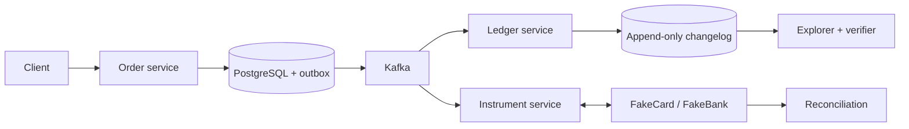

<div align="center">

# ZeroSum Ledger

**Every movement of money should leave a balanced, explainable trail.**

A Java 25 / Spring Boot payments-system lab with an immutable ledger, transactional outbox,
Kafka delivery, simulated payment providers, reconciliation, and fault-injection evidence.

[](https://github.com/ai-calypse/zerosum-ledger/actions/workflows/ci.yml)
[](https://github.com/ai-calypse/zerosum-ledger/actions/workflows/codeql.yml)
[](LICENSE)

[Engineering report](docs/engineering-report.md) · [Architecture & tradeoffs](ARCHITECTURE.md) · [Decision records](docs/adr/) · [Demo](docs/demo.md)


</div>

This is a portfolio and learning project. All payments use fake providers and simulated funds.

## What makes it interesting?

| Failure to design for | Implementation | Evidence |
| --- | --- | --- |
| A process commits an order and dies before publishing | Transactional outbox + replay + idempotent apply | [Crash recovery](docs/results/s08/m4a-crash-recovery.md) |
| A provider commits a charge but the response is lost | Explicit `UNKNOWN` outcomes, lookup, and recovery | [10,000-attempt experiment](docs/results/s08/m8b-card-timeout-volume.md) |
| Application code bypasses a balance check | Deferred database constraints enforce zero sum per currency | [Ledger architecture](docs/architecture.md) |
| A settlement report disagrees with internal books | Typed reconciliation breaks preserve the discrepancy | [Live reconciliation](docs/results/s06/reconciliation-live.md) |
| Many writers contend on one account | Per-entity locking, batching, and measured account spreading | [Performance study](docs/results/perf/quiet-rerun.md) |



## Measured results

| Historical result | Conditions and source |
| --- | --- |
| API acknowledgment p95 **1.63 ms** at 200 requests/s | Laptop / Docker Desktop, durability enabled; [API study](docs/results/perf/p1-api-ack.md) |
| **300,000** orders at 500/s, **0 missing**, order-to-ledger p99 **76 ms** | Ten-minute sustained run; [quiet rerun](docs/results/perf/quiet-rerun.md) |
| **100/100** committed orders published after a publisher crash | Duplicate Kafka delivery absorbed; [crash recovery](docs/results/s08/m4a-crash-recovery.md) |
| Removing individual safeguards causes the predicted failures | 60 fault runs; [ablation results](docs/results/s08/ablation-results.md) |

These figures describe the documented experiments on one Apple M4 laptop. They are not production capacity
claims. Reports include seeds, versions, git provenance, and limitations. [Full evidence index](docs/engineering-report.md#evidence-index).

## Run locally

Prerequisites: Docker Engine with Compose v2, `openssl`, and a JDK that can run the Gradle wrapper.
The build provisions the pinned Java 25 toolchain. Docker needs sufficient memory for PostgreSQL, Kafka,
four services, and the observability stack; see the [topology](docs/zerosum_ledger_mvp_plan.md#topology).

```sh
git clone https://github.com/ai-calypse/zerosum-ledger.git
cd zerosum-ledger
make env       # generate ignored, throwaway local secrets
make up        # build and start the local stack and one-origin proxy
make demo      # exercise the money path with simulated providers
make explorer  # open http://127.0.0.1:8080/explorer.html
```

Enter the reader/admin tokens from your local `.env` into the Explorer when requested. Tokens are kept in
memory. Do not paste them into an issue, screenshot, or recording.

```sh
make test         # compile and fast tests; no running stack needed
make integration  # Testcontainers: real PostgreSQL and Kafka; Docker required
make e2e          # end-to-end tests against the running local stack
```

`make down` stops this Compose project **and deletes its local data volumes**. Chaos tests are a separate,
explicit task because they kill services and disrupt the broker; see [Contributing](CONTRIBUTING.md).

## Quality and delivery

PRs run unit and Testcontainers integration layers, workflow validation, documentation links, dependency
review, and CodeQL. Nightly/manual CI runs the Compose end-to-end layer. Test reports are retained as CI
artifacts. Version tags validate the build and integration suite, publish versioned service images to GHCR,
and prepare a draft GitHub release. [Maintenance and releases](docs/maintaining.md).

## Explore the design

- [Ten architecture decisions](docs/adr/), including sign conventions, partitioning, and provider abstraction.
- [Invariant verifier and acceptance criteria](docs/architecture.md), including partial and unmet criteria.
- [Operational runbook](docs/runbook.md), [secret handling](docs/secrets.md), and [scope decisions](docs/scope-decisions.md).
- [Complete engineering report](docs/engineering-report.md) and [documentation index](docs/README.md).

The local topology uses one broker and one database server. Production HA, operational certification,
and real payment integrations are outside its scope.

[Contributing](CONTRIBUTING.md) · [Security](SECURITY.md) · [MIT license](LICENSE)
