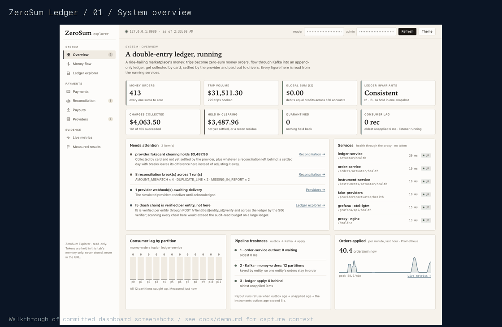

# Demo: follow simulated money through the system

Use a disposable local stack and generated local secrets. No real financial provider is contacted.

```sh
make env
make up
make demo
make explorer
```

## Walkthrough

1. Enter local reader/admin tokens in the Explorer. Keep these password fields masked in all recordings.
2. Open Overview to inspect service health, freshness, and invariant checks.
3. Open Money flow and Ledger explorer to connect a balanced order to its append-only audit trail.
4. Open Payments to inspect attempts and explicit uncertain outcomes.
5. Open Reconciliation and Payouts; explain discrepancies instead of silently balancing them away.
6. Read Measured results separately from live state: those figures are historical evidence.

The repository contains genuine dashboard screenshots under [images/](images/). This animated walkthrough
is assembled from those committed screenshots. It is a visual guide to the interface, not a new continuous
screen recording or a new performance measurement. Fresh local validation is reported separately in the PR.



[Architecture](architecture.md) · [Performance evidence](results/perf/perf-summary.md) · [Runbook](runbook.md).

`make down` deletes this Compose project's data volumes. Chaos tests are deliberately excluded from the normal
walkthrough. Never record local `.env` contents or private tokens.
